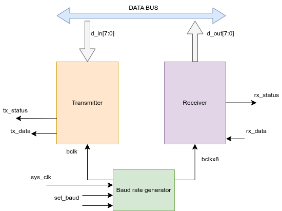
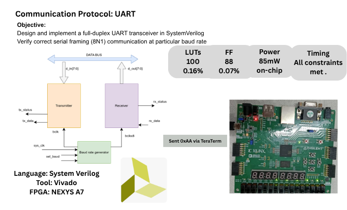

# UART Implementation Using SystemVerilog and FPGA

## Overview

This project implements a modular Universal Asynchronous Receiver/Transmitter (UART) design using SystemVerilog and an FPGA development workflow. The design was implemented on a **Digilent Nexys A7 FPGA board** using AMD Vivado, and serial output was observed using Tera Term.

The project demonstrates modular RTL design, finite-state machine implementation, FPGA implementation, and hardware-level serial communication validation.

## Objectives

- Develop modular UART RTL using SystemVerilog.
- Integrate the design components through a top-level module.
- Implement the design on FPGA hardware.
- Observe and validate serial output using a terminal application.
- Organize RTL, constraints, implementation files, and documentation for reuse.

## Hardware and Tools

| Component | Details |
|---|---|
| Hardware description language | SystemVerilog |
| FPGA development board | Digilent Nexys A7 |
| FPGA development tool | AMD Vivado |
| Serial terminal | Tera Term |
| Communication protocol | UART |

## Project Structure

```text
uart-systemverilog-fpga/
├── RTL/
│   ├── UART_Top.sv
│   ├── Transmitter.sv
│   ├── Receiver.sv
│   └── BaudRate.sv
├── Constraints/
│   └── UART.xdc
├── Bitstream/
│   └── UART_Top.bit
├── images/
│   ├── UART_Architecture.png
│   └── Protocol_Implementation.png
└── README.md
```

## Design Overview

The design follows a modular RTL architecture, separating the main UART functions into individual SystemVerilog modules.

- **UART Top Module (`UART_Top.sv`):** Integrates the design components.
- **Transmitter (`Transmitter.sv`):** Implements the UART serial transmission logic.
- **Receiver (`Receiver.sv`):** Implements the UART reception logic.
- **Baud Rate (`BaudRate.sv`):** Provides timing control for UART communication.

### UART Architecture



### UART Protocol Implementation



## FPGA Implementation and Validation

The design was implemented on a Digilent Nexys A7 FPGA board using AMD Vivado. The FPGA's serial output was observed using Tera Term to evaluate the implemented communication behavior.

The project includes the RTL source files, FPGA constraints, and a generated bitstream to document the implementation workflow.

## Key Skills Demonstrated

- SystemVerilog RTL development
- Modular digital system design
- Finite state machine implementation
- UART serial communication
- FPGA synthesis and implementation
- Hardware bring-up and debugging
- FPGA-to-PC serial communication

## Repository Contents

The repository provides the SystemVerilog source code, FPGA constraints, generated bitstream, and design diagrams for understanding the implementation.

